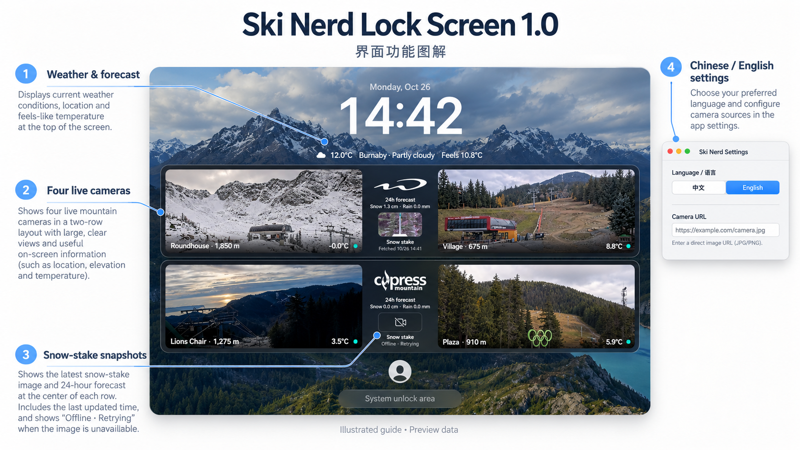
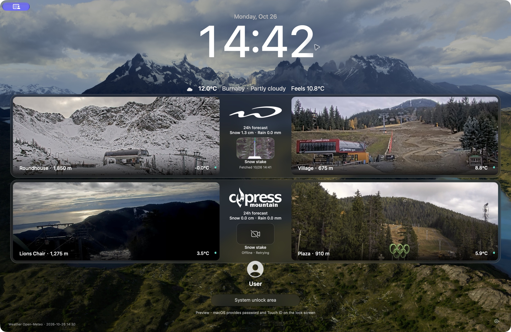
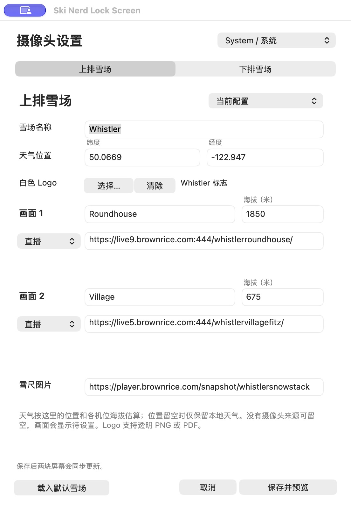
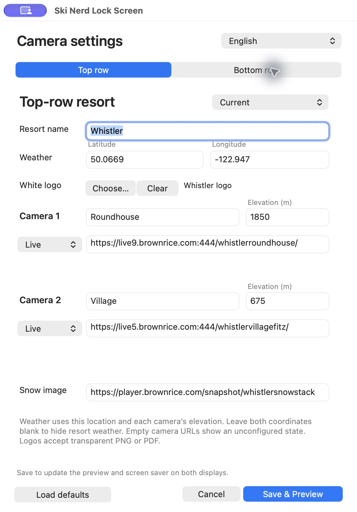

<div align="center">

# Ski Nerd Lock Screen 1.0

**锁屏后，一眼看到山上。**

原生 macOS 屏保 · 四路可替换摄像头 · 雪尺 · 天气

[下载 1.0](https://github.com/MK420-max/ski-nerd-lock-screen/releases/tag/v1.0) · [English](README.md)



</div>

> 上图为 AI 生成的功能图解。下方设置窗口与预览来自原生程序实拍，账户名称使用通用示例。天气和摄像头画面随时间变化。

## 功能

- 上下两排连贯玻璃栏，每排两个大画面；中央显示白色 Logo、24 小时雨雪预报和小雪尺。
- 支持更换任意雪场名称、Logo、经纬度、机位名称、海拔及公开摄像头地址；默认提供 Whistler、Cypress。
- 直播支持公开 HTTPS HLS、YouTube、CamStreamer；定时图片每 60 秒更新。雪尺离线时如实显示“离线 · 自动重试”。
- 设置界面、预览与屏保支持简体中文、英文、跟随系统。摄像头自定义名称保留原文。
- 两块屏幕同步使用内置屏桌面壁纸，保留 macOS 的时钟和密码输入区域。
- 无账号、无分析上报、无日历读取、无录像；程序不接收或处理解锁密码。

## 实际界面



<table><tr>
<td width="50%"></td>
<td width="50%"></td>
</tr></table>

## 安装

1. 在 [Releases](https://github.com/MK420-max/ski-nerd-lock-screen/releases/tag/v1.0) 下载并完整解压 **Ski-Nerd-Lock-Screen-1.0-macOS-arm64.zip**。
2. 运行 **Install.command**，安装设置应用、屏保和两个当前用户后台组件。发布包自带 Python 解析运行时与 Node，运行时无需安装 Homebrew 或开发工具。
3. 从用户“应用程序”文件夹打开 **Ski Nerd Lock Screen**。
4. 在“系统设置 → 墙纸 → 屏幕保护程序”选择 **Mountain Cams**。为兼容已有安装，系统屏保内部名称保持此名称。
5. 保存配置并查看预览，再按平常方式锁屏。

需要 **Apple 芯片、macOS 26 或更新版本、网络连接**。安装包采用临时签名，**未经过 Apple 公证**；系统可能要求在“隐私与安全性”中审核后才能打开。请保留 Gatekeeper。当前没有 Intel 安装包。

## 更换摄像头

在应用中选择“上排雪场”或“下排雪场”：

1. 填写名称，选择可选的透明 PNG／PDF Logo。
2. 填写天气经纬度；两项同时留空可关闭该雪场天气。
3. 填写两个机位的名称和海拔米数。
4. 直播地址选择“直播”；直接 HTTPS 图片地址选择“定时图片”。
5. 填写可选的雪尺图片地址，点击“保存并预览”。

语言切换选择“简体中文／English／System”，保存后应用到设置、预览与屏保。macOS 自带提示框仍跟随系统语言。没有全球摄像头搜索、登录或 Cookie 接入。

| 快捷键 | 功能 |
| --- | --- |
| ⌘, | 打开设置 |
| ⌘P | 打开预览 |
| ⇧⌘D | 两块屏幕一起预览 |
| ⌘Q | 退出设置／预览应用 |

## 数据与隐私

摄像头配置和 Logo 只保存在本机 `~/Library/Application Support/MountainCams/`。解析服务只监听 `127.0.0.1:48764`，向公开直播提供方请求播放地址；天气请求将所填雪场经纬度发送给 Open-Meteo。

仓库及安装包已排除个人配置、机器用户名、绝对主目录路径、调试日志、密钥和缓存画面。默认来源为公开雪场地址，账户示例使用通用名称。

## 已知限制

- 1.0 的城市天气固定为 **Burnaby, BC**，预览时间使用 **America/Vancouver**；雪场经纬度和海拔可修改，真实锁屏时钟由 macOS 管理。
- 天气是模型估算；雪／雨量为未来 24 个预报小时，取图时间也不代表摄像头拍摄时间。
- Cypress 原雪尺地址在验证时不可用，保留离线重试提示，可自行更换来源。
- 播放取决于公开源、网络和系统电源状态；双屏每屏播放四路，会消耗带宽与电量。
- 锁屏布局已在一台 Apple 芯片 Mac 的内置屏和外接屏上确认。其他尺寸与后续系统版本应另行检查。

## 从源码构建

需 Xcode Command Line Tools 与 macOS 26+ SDK：

```sh
zsh src/build.sh
zsh scripts/test.sh
```

构建结果在 `build/`。完整 ZIP 可在 Python 3.12 环境安装 `scripts/requirements-release.txt`，并准备 PATH 中的 Node 后，执行 `zsh scripts/package.sh`。发布验证见 [VERIFICATION.md](docs/VERIFICATION.md)，第三方说明见 [THIRD_PARTY_NOTICES.md](THIRD_PARTY_NOTICES.md)。

## 许可

项目源码使用 [MIT](LICENSE)。雪场名称、Logo、摄像头影像、壁纸及第三方依赖保留各自权利。本项目独立开发，与 Apple 或相关雪场及直播提供方没有隶属关系。
